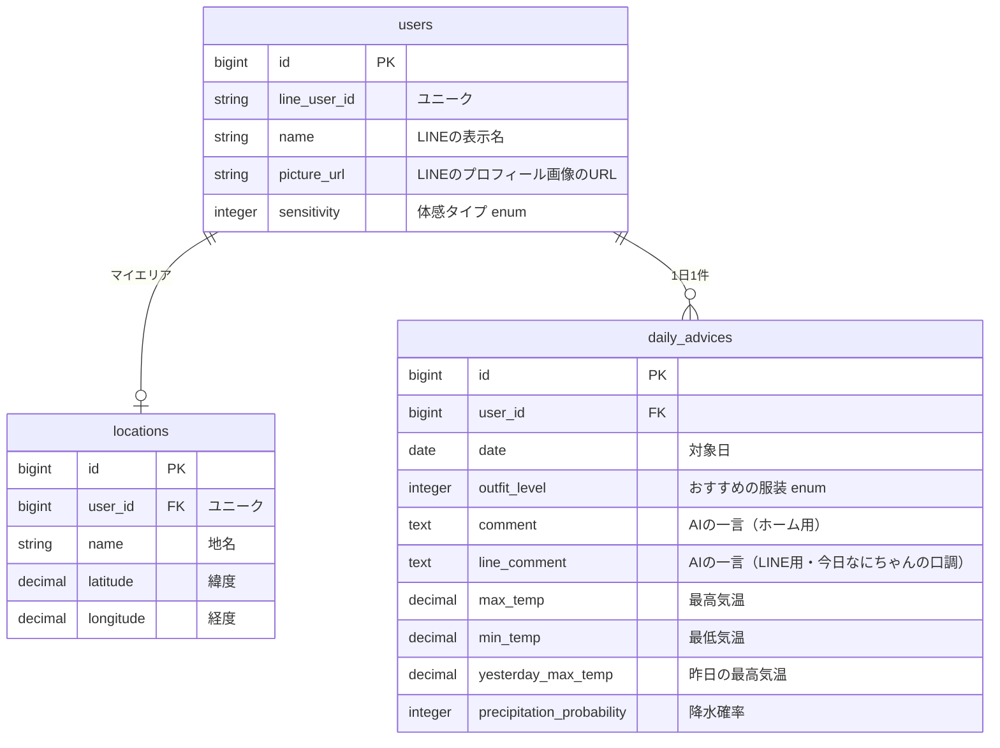

# 今日なに着てく？

毎朝7時に、今日の天気に合わせた服装アドバイスをLINEに届けるアプリです。
地名を検索すれば、ログインなしでも今日の天気と服装の目安を確認できます。

**アプリ**：https://kyo-nani-kiteku.onrender.com

<!-- OGP 画像（#32）をここに入れる -->

## 作成理由

複数のAPIをつないで「人の代わりに自動で動く仕組み」を作ってみたかったため。
あわせて、毎朝「何着よう」とお天気アプリを開く手間をなくすことが目的です。

## 主な機能

- 地名を検索して、今日の天気とおすすめの服装をチェック（ログイン不要）
- LINEログインして、マイエリアと体感タイプ（暑がり／ふつう／寒がり）を登録
- 毎朝7時に、天気とおすすめの服装をLINEでお届け（キャラクター「今日なにちゃん」のAIの一言つき）
- ホームで、マイエリアの今日の天気・服装・AIの一言を確認

## 仕組み

```
⏰ 毎朝7:00（Solid Queue の定期実行）
   ↓
☁️ ユーザーごとに天気を取得（Open-Meteo）
   ↓
👕 おすすめの服装（6パターン）と傘・暑さ注意のマークをルールで判定
   ↓
🤖 判定結果をもとにAIが一言アドバイスを生成（Gemini API）
   ↓
📱 LINEに通知（LINE Messaging API）
```

服装とマークはルールで判定し、AIには一言コメントの生成を任せる。

## 画面

<!-- スクリーンショット（トップ・ホーム・しらべる・設定・LINE の通知）をここに入れる -->

| 画面 | 内容 |
|---|---|
| トップ | 地名を検索して、今日の天気とおすすめの服装を見る。LINEログインボタン |
| ホーム | マイエリアの今日の天気・服装・AIのひとこと |
| しらべる | ログイン中に、ほかの場所の天気を調べる |
| 設定 | マイエリアと体感タイプの登録、ログアウト |

## ER 図



## 使用技術

| 分類 | 技術 |
|---|---|
| 言語・フレームワーク | Ruby 4.0.2 / Ruby on Rails 8.1.3 |
| フロントエンド | Hotwire（Turbo）/ Importmap / CSS |
| データベース | PostgreSQL 17（本番は Neon） |
| インフラ | Render / Docker |
| 定期実行 | Solid Queue（recurring tasks） |
| 外部API | Open-Meteo API / 国土地理院 地名検索API / Gemini API（gemini-3.5-flash-lite）/ LINEログイン / LINE Messaging API |
| テスト | RSpec |
| CI/CD | GitHub Actions / Render |

## 工夫した点

- **日本の「区」まで調べられる地名検索**：Open-Meteo の地名検索では「渋谷区」のような区の名前が見つからなかったため、国土地理院 地名検索API で候補を出し、選んだ場所の緯度・経度で天気を取るようにした。候補の一覧は Turbo Frame で、ページを読み直さずに表示する
- **服装はルール、AIは一言だけ**：服装（6段階）・傘・暑さのマークの判定を AI に任せると、日によって答えがぶれたり、まちがった服装をすすめたりするおそれがある。判定は Ruby のルールで決め、Gemini にはその結果をもとにした一言だけを書いてもらう
- **AIのひとことは1日1回作って保存**：AIのひとことは毎朝のLINE通知のタイミングで `daily_advices` テーブルに保存し、ホームでも同じひとことを出す。LINE とアプリで表示が揃い、Gemini を呼ぶ回数も1人1日1回ですむ
- **失敗しても止まらないしくみ**：Gemini が失敗したら服装ごとの説明文を出す、Open-Meteo から天気が取れなければ画面にメッセージを出す、1人に通知を送れなくてもほかの人には送る
- **画面の数字と判定をそろえる**：画面には四捨五入した気温を出すので、服装の判定も同じ四捨五入した気温で行う
- **外部のAPIに頼らないテスト**：Open-Meteo・国土地理院・Gemini・LINE の API はすべて WebMock で偽物の返事に差し替えた。テストのたびに本物の LINE が送られたり無料枠を使ったりせず、本物の API キーがなくても CI で動く。「降水確率60%」「Gemini が503で失敗」のような状況もいつでも作れるので、失敗したときの動きまでテストできる

## 詰まった点

- **Open-Meteo の地名検索で、区の名前が見つからない**：天気を取るには、地名を緯度・経度に変える必要がある。最初は Open-Meteo の地名検索を使ったが、「渋谷区」「新宿区」が見つからず、「区」を外して検索すると、「浦安」で千葉県ではなく鳥取県の浦安が出るなど、同じ名前の別の場所が出てきた。地名検索だけ国土地理院 地名検索API に変え、候補から選んでもらう形にした
- **AI のモデルが混んでいて失敗する**：誤変換を減らそうと `gemini-3.5-flash` を試したが、無料枠では混雑していて3回中2回が失敗（503・タイムアウト）し、成功しても12秒以上かかった。毎朝の通知で失敗しにくいよう、1〜3秒で返ってくる `gemini-3.5-flash-lite` にした
- **画面の気温と服装が合わない**：最高気温 24.6℃ を画面では「25℃」と出していたのに、判定は 24.6℃ で行っていたため、25℃ から半袖なのに長袖をすすめる日があった。判定にも四捨五入した気温を使うようにして、画面と服装の判定をそろえた

## 設計判断

「なぜそうしたか」は [docs/design-decisions.md](docs/design-decisions.md) に記録しています。
